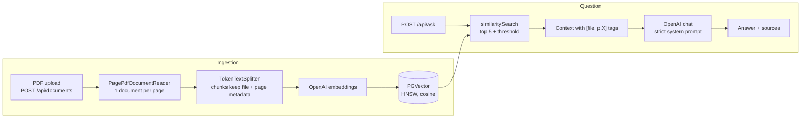

# reg-assistant

[](https://github.com/RA3D/reg-assistant/actions/workflows/ci.yml)


[](LICENSE)

A small RAG (retrieval-augmented generation) assistant over **public banking regulations**: EBA guidelines, EU regulations such as DORA or CRR.

You upload regulation PDFs, ask a question in plain English, and get an answer where **every claim cites the source file and page number**. If the documents don't contain the answer, it says "I don't know" instead of guessing.

I built it because in banking, an AI answer you can't trace back to a page of the source text is useless: compliance teams need to check it.

## Architecture



## Tech stack

- Java 21, Spring Boot 3.5, Maven
- Spring AI 1.0 (OpenAI chat + embeddings, PGVector store, PDF reader)
- PostgreSQL 16 + pgvector (Docker)
- JUnit 5 / AssertJ, GitHub Actions

## Quick start

Prerequisites: Java 21, Maven, Docker, an OpenAI API key.

```bash
git clone https://github.com/RA3D/reg-assistant.git
cd reg-assistant

docker compose up -d            # PostgreSQL + pgvector on localhost:5432
export OPENAI_API_KEY=sk-...
mvn spring-boot:run
```

The vector table and HNSW index are created on first start (`initialize-schema: true`).

Health check:

```bash
curl http://localhost:8080/actuator/health
```

## Usage

Download a public regulation, for example DORA from EUR-Lex (https://eur-lex.europa.eu/eli/reg/2022/2554/oj) or EBA guidelines from https://www.eba.europa.eu, and put it in a `samples/` folder (ignored by git).

**Upload a PDF**

```bash
curl -F "file=@samples/DORA.pdf" http://localhost:8080/api/documents
```

```json
{ "file": "DORA.pdf", "pages": 79, "chunks": 212 }
```

**Ask a question**

```bash
curl -X POST http://localhost:8080/api/ask \
  -H "Content-Type: application/json" \
  -d '{"question": "What must a financial entity do when a major ICT-related incident occurs?"}'
```

Example response (yours will differ depending on the documents loaded):

```json
{
  "answer": "Financial entities must report major ICT-related incidents to the relevant competent authority [DORA.pdf, p.37]. ...",
  "sources": [
    { "file": "DORA.pdf", "page": 37, "score": 0.812 },
    { "file": "DORA.pdf", "page": 38, "score": 0.744 }
  ]
}
```

A question outside the documents returns `"I don't know based on the provided documents."` with no sources.

## Configuration

| Property | Default | Meaning |
|---|---|---|
| `reg-assistant.retrieval.top-k` | `5` | Number of chunks sent to the model |
| `reg-assistant.retrieval.similarity-threshold` | `0.4` | Minimum cosine similarity to keep a chunk |
| `spring.ai.openai.chat.options.model` | `gpt-4o-mini` | Chat model |
| `spring.ai.openai.embedding.options.model` | `text-embedding-3-small` | Embedding model (1536 dims) |

### Switching to Ollama (local models)

1. In `pom.xml`, replace `spring-ai-starter-model-openai` with `spring-ai-starter-model-ollama`.
2. In `application.yml`, replace the `openai` block with:
   ```yaml
   spring.ai.ollama:
     chat.options.model: llama3.1
     embedding.options.model: nomic-embed-text
   ```
3. Set `spring.ai.vectorstore.pgvector.dimensions: 768` and drop the existing `vector_store` table (the dimensions changed).

No Java code changes: the services only depend on Spring AI's `ChatModel` and `VectorStore` interfaces.

## Design decisions

- **One document per PDF page.** `PagePdfDocumentReader` keeps the page number in the metadata, and the splitter copies it into every chunk. That's what makes page-level citations possible without any custom parsing.
- **Manual retrieval instead of an advisor.** Spring AI has a `QuestionAnswerAdvisor`, but I call `similaritySearch` myself. It keeps the flow explicit, lets me build the context with `[file, p.X]` tags, return the sources in the API response, and unit test the context building.
- **No LLM call when nothing is retrieved.** If no chunk passes the similarity threshold, the API answers "I don't know" directly. It's cheaper and removes the risk of the model answering from its own knowledge.
- **Strict system prompt, temperature 0.** The model must answer only from the context, cite every factual sentence, and use a fixed "I don't know" sentence otherwise.
- **Plain messages, no prompt templating.** The context goes into a plain `UserMessage`. Regulation PDFs can contain `{` and `}`, which would break template rendering.
- **HNSW + cosine in PGVector.** Good recall and speed without a separate vector database: banks already run PostgreSQL, so this is easy to operate.

## Tests

```bash
mvn verify
```

Unit tests cover context building and source mapping. They run without a database or an API key, so CI stays fast and free.

## Roadmap

- [ ] **Evaluation set**: 30–50 questions with expected pages, to measure retrieval hit rate and citation accuracy, and tune top-k / threshold
- [ ] **Kafka ingestion**: publish "new regulation" events and ingest asynchronously, with idempotency (skip a PDF already ingested, by checksum)
- [ ] **Observability**: Micrometer + Prometheus + Grafana, OpenTelemetry traces for retrieval and LLM calls, token usage and latency metrics
- [ ] **MCP server**: expose `search_regulation` and `ask_regulation` as MCP tools so AI agents can use the knowledge base
- [ ] **Azure deployment**: Azure Container Apps + Azure Database for PostgreSQL (pgvector), Azure OpenAI, secrets in Key Vault
- [ ] Upgrade to Spring Boot 4 / Spring AI 2.0

## License

MIT, see [LICENSE](LICENSE). The regulation texts belong to their publishers (EUR-Lex, EBA) and are not included in this repository.
